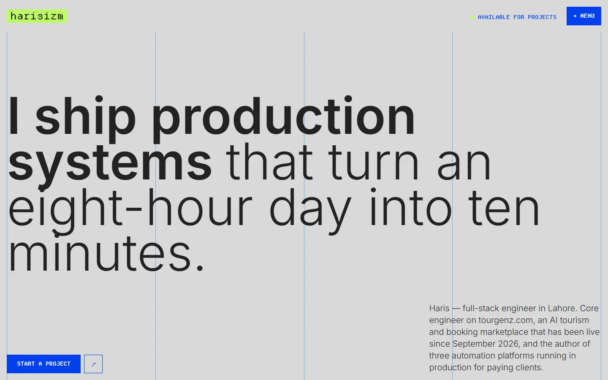
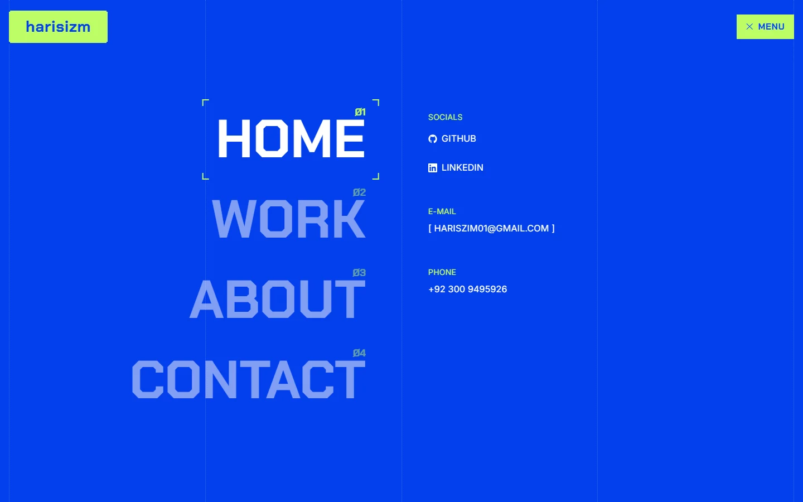
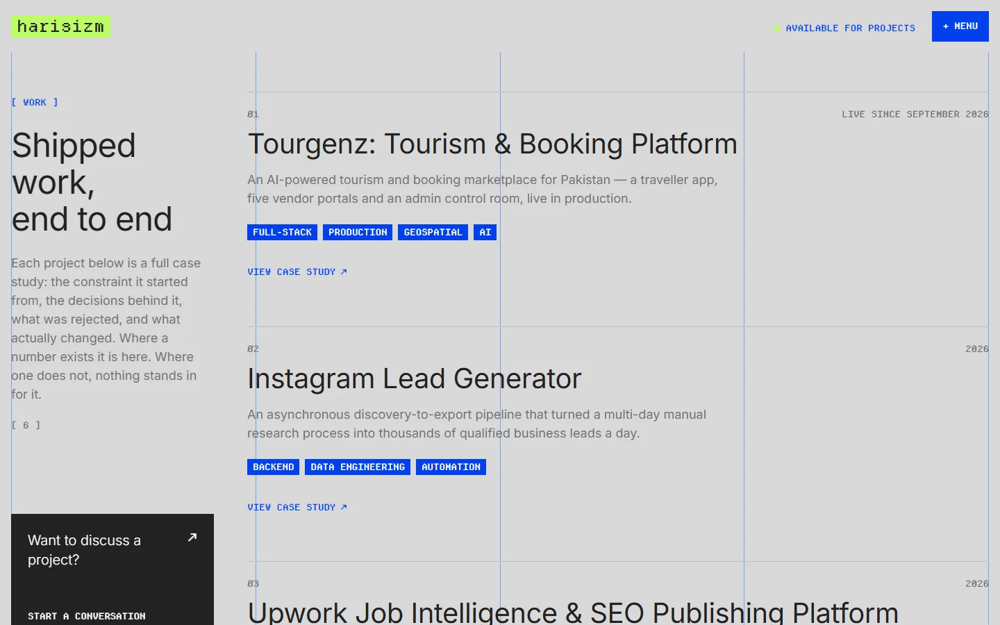
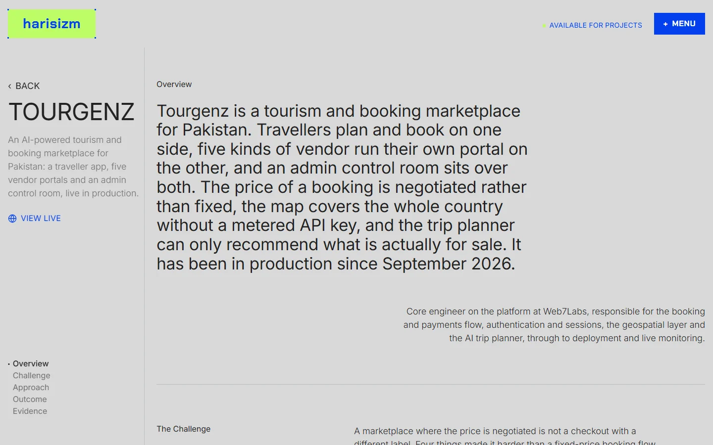

<div align="center">

# harisizm.com

**Portfolio V3 — Hafiz Muhammad Haris**

Full-stack engineer in Lahore. Every project on this site is a full case study:
the constraint it started from, the decisions behind it, **what was rejected**,
and what actually changed.

`Next.js 16` · `React 19` · `TypeScript strict` · `Tailwind v4` · `Chakra Petch + Inter`

</div>

---



## What this is

The third pass at the portfolio, and the first one built around a single idea:
**a project card is a summary; a case study is an argument.**

V2 gave each project three bullets and a screenshot. V3 gives each one a narrative
with a sticky rail, a scroll-spy, and a section that names the alternative that was
considered and thrown away. That last part is the whole point — a list of features
is output, a rejected alternative is thinking.

The content comes from the October 2026 CV: two engineering roles, one live
production platform, and three automation systems.

---

## Stack

| Layer | Choice | Why |
|---|---|---|
| Framework | **Next.js 16** (App Router) + React 19 | Matches the daily stack at Web7Labs, so the site is itself consistent with what the CV claims |
| Language | **TypeScript**, `strict` | Build fails on a type error rather than shipping a broken page |
| Styling | **Tailwind v4** via PostCSS | Tokens live as CSS custom properties, exposed to utilities through `@theme inline` |
| Display face | **Chakra Petch 700** (SIL OFL, via `next/font`) | Squared technical face for the logo, chips, menu, step names, numbers and wordmark |
| Body face | **Inter** via `next/font` | Everything a human reads in a sentence |
| Motion | `motion` (framer-motion's successor) | Page transitions with real exit frames, a cover that flies from card to case study, split-line headlines, staggers, count-ups, a marquee, a magnetic pointer on links. Every effect resolves to its final state with JavaScript off or under reduced motion |
| Images | AVIF → WebP via `next/image` | V2 shipped ~8 MB of PNGs |

---

## The menu



A full-viewport overlay in the one accent blue, with the dotted column rules still
visible through it. Nav items sit in the display face at up to 96px, numbered `Ø1`–`Ø4`
in lime.

The detail that carries it: **a reticle of four lime crop marks frames the hovered
item and moves between items as one continuous element**, measured with FLIP rather
than four brackets fading in and out. Under `prefers-reduced-motion` it snaps instead
of animating — it does not merely animate faster.

It is also a real dialog: focus is trapped inside it, `Escape` closes it, focus
returns to the trigger on close, `aria-expanded` tracks state, and body scroll is
locked with the scrollbar width compensated so the header does not jump.

---

## The work index



A sticky left column holds the page label, the heading, and a dark
*"Want to discuss a project?"* panel pinned to its bottom — so the context and the
call to action stay on screen for the entire scroll while the projects pass on the
right.

Persistent context, scrolling evidence, an always-present exit.

---

## The case study



The centre of the site. A sticky rail carries `‹ BACK`, the title, the live link and
a scroll-spy nav; the right column runs
`Overview → Challenge → Approach → Outcome → Evidence → Next Up`.

Three things it does that most portfolios do not:

- **Names what was rejected.** Each approach step can carry the alternative that was
  considered and discarded, with the reason. *"A metered commercial maps provider,
  which puts a per-environment key and a usage bill in front of a feature the product
  leans on constantly."*
- **Renders nothing it does not have.** No deployment means no live button — not a
  greyed-out one, not one pointing at `#`. Sections with no content collapse entirely
  rather than printing a placeholder.
- **Never dead-ends.** Every case study exits to the index, the next project, or
  contact.

On mobile the rail collapses to a static header and the scroll-spy becomes a thin
sticky progress bar — `▪ The Approach · Ø3 / Ø5`.

---

## Design system

Two accents, and nothing else. The restraint is the system.

```css
--canvas:    #D9D9D9   /* warm grey. not white */
--ink:       #222222
--accent:    #033FED   /* every interactive affordance */
--accent-2:  #BEFD66   /* identity and state only */
--mid-grey:  #727272   /* the readable secondary */
--grid-line: #2467EC   /* the dotted column rules */
```

**The grid is visible.** Four columns with dotted rules on every boundary, drawn in
production as a motif rather than as a dev tool. It is what makes the whitespace read
as composed rather than empty.

**The cursors are three 32×32 vector SVGs**, swapped with plain CSS — no JavaScript
follower, so they never lag the pointer. Clean geometric shapes with a white core
inside a black outline, so they read on both the grey canvas and the blue overlay,
and scale evenly at 125% and 150% Windows DPI (a 2× variant ships via `image-set()`).

**The hero sets one sentence in two weights at one size** — the opening clause at 600,
the resolving clause at 300. Hierarchy without a change of size or colour.

**Motion is a layer, not the content.** `src/components/motion/README.md` documents
the primitive set; nothing in the pages imports the library directly. A boot script
decides before the body parses whether entering elements stay hidden, so a reader
with JavaScript off or reduced motion on sees every section at once.

Full spec: **[`design.md`](design.md)**.

---

## Repository

```
design.md                  THE SPEC — tokens, grid, type, components,
                           page architecture, the case-study template
lessons.md                 Decisions (D-nnn) and dead ends (T-nnn)
CLAUDE.md                  Working rules + what is still outstanding

src/
├── app/                   routes + globals.css (every token)
├── components/
│   ├── ui/                design-system primitives
│   ├── layout/            header, menu overlay, footer, hero rail
│   └── home|work|about|contact/
├── data/                  typed content layer — the only source of content
├── hooks/                 useReveal · useScrollSpy · useReducedMotion
└── lib/site.ts            identity + contact, single source of truth

public/cursor/             three vector cursors, 1× and 2×
context/                   reference teardown, portfolio principles, V2 post-mortem
reference/nvrmnd/          41 annotated screenshots of the design reference
```

---

## The rules that matter

Each one exists because V2 got it wrong. Full detail in
[`lessons.md`](lessons.md).

| | Rule | The V2 defect it closes |
|---|---|---|
| 1 | Every interactive element resolves to a real destination | The **"Hire me" button had no `onClick` and no `href`** — the primary conversion control was inert |
| 2 | No root font-size hack | `html { font-size: 77% }` silently broke every `rem` on the site |
| 3 | Content lives in the typed data layer | Projects and copy were object literals inside 500-line components |
| 4 | `prefers-reduced-motion` honoured by every animation | Infinite marquees ran unconditionally, with no guard anywhere |
| 5 | Contact works with no hover and no JavaScript | There was **no `mailto:` anywhere**; the email needed a hover, a click and a toast |
| 6 | Page weight under 1 MB | V2 shipped ~8 MB of PNGs, decoding each screenshot twice |
| 7 | Nothing invented | No fabricated testimonials, no placeholder metrics dressed as real |

Rule 7 is load-bearing. There are no client testimonials yet, so the case studies
close on an **Evidence** slot that takes real usage numbers and live links. The
testimonial branch is fully built and currently unused — a real quote drops in with
no redesign, and one lacking permission to publish is withheld automatically.

---

## Running it

```bash
npm install
npm run dev        # http://localhost:3000
npm run build
npm run typecheck  # tsc --noEmit
npm run lint
```

---

## Status

Thirteen routes, all statically prerendered. `typecheck`, `lint` and `build` pass clean.

Outstanding, tracked in [`CLAUDE.md`](CLAUDE.md):

- Repo links and cover art for several projects — fields are `null`, so no control
  renders and a designed placeholder frame stands in
- Per-project sign-off on the four case studies describing employer work; they are
  seeded `approvalStatus: "draft"` and gated behind `approvedProjects()`
- Three process diagrams
- Final hero line — alternatives sit in a comment at the top of `Hero.tsx`

---

## Design reference

The visual system is modelled closely on [nvrmndstudio.com](https://www.nvrmndstudio.com),
a deliberate and recorded decision ([`lessons.md`](lessons.md) D-002).
[`context/reference-nvrmnd.md`](context/reference-nvrmnd.md) documents what was
measured and why — including the defects that were **not** carried over: it ships zero
`prefers-reduced-motion` rules, and drops its case-study scroll-spy entirely on mobile
across a nine-screen page.

Both of that site's typefaces are commercially licensed and are **not** reused here.
Off-Bit is a Power Type Foundry release that is free for personal use only, and SF Pro
is licensed by Apple for interface design on Apple platforms — neither covers a
commercial site. Chakra Petch (SIL OFL) and Inter (SIL OFL) stand in for them, behind
`--font-display` and `--font-body` tokens so either can be swapped in one line.

`reference/nvrmnd/` is an archive. Read it; never import from it, never ship it.

---

<div align="center">

**[hariszim01@gmail.com](mailto:hariszim01@gmail.com)** · [github.com/harisizm](https://github.com/harisizm) · [linkedin.com/in/harisizm](https://www.linkedin.com/in/harisizm)

</div>
